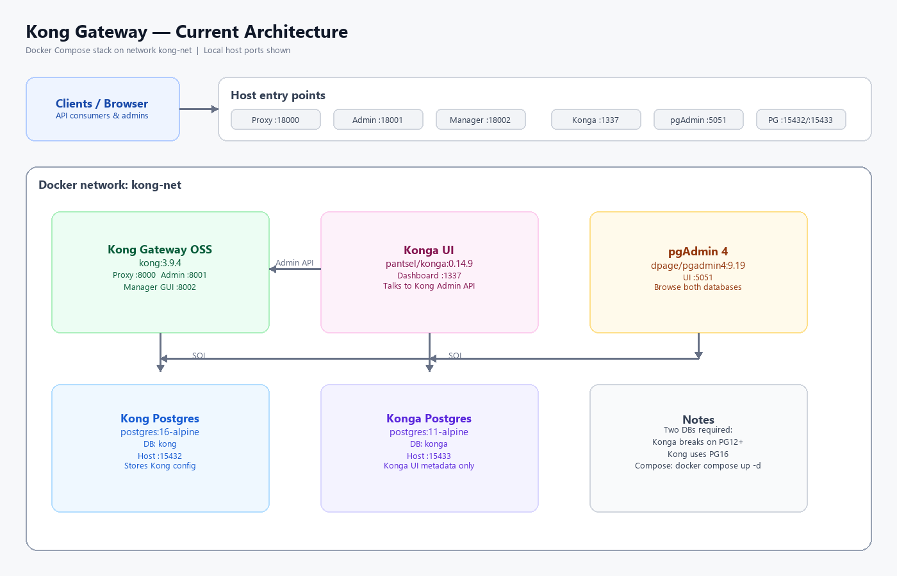

# Kong Gateway

Local Kong API Gateway stack with PostgreSQL, pgAdmin, and Konga.

## Architecture



| Component | Image | Role |
|-----------|--------|------|
| **Kong** | `kong:3.9.4` | API gateway (proxy + Admin API) |
| **Kong Postgres** | `postgres:16-alpine` | Kong configuration database |
| **Konga** | `pantsel/konga:0.14.9` | Web UI for Kong Admin API |
| **Konga Postgres** | `postgres:11-alpine` | Konga UI metadata (PG11 required) |
| **pgAdmin** | `dpage/pgadmin4:9.19` | Browse both Postgres databases |

All services run on Docker network `kong-net`.

## Quick start

```bash
docker compose up -d
```

```bash
docker compose down
# wipe DB volumes:
docker compose down -v
```

## URLs

Host ports avoid clashes with Work Order (`:8002`) and other local Kong/k8s usage (`:8000`).

| Service | URL |
|---------|-----|
| Kong proxy | http://localhost:18000 |
| Kong Admin API | http://localhost:18001 |
| Kong Manager | http://localhost:18002 |
| Konga | http://localhost:1337 |
| pgAdmin | http://localhost:5051 |
| Kong Postgres | `localhost:15432` |
| Konga Postgres | `localhost:15433` |

## Login credentials

### pgAdmin

| Field | Value |
|-------|--------|
| URL | http://localhost:5051 |
| Email | `admin@local.dev` |
| Password | `admin` |

1. Open http://localhost:5051 — you get the **pgAdmin login page** (not a DB password prompt).
2. Sign in with:
   - Email: `admin@local.dev`
   - Password: `admin`
3. After login, **Kong Postgres (config DB)** and **Konga Postgres (UI DB)** are already registered and use a saved `pgpass`, so they should connect without asking for database passwords again.

If a DB password prompt still appears once, use:

- Kong DB: `kong` / `kong`
- Konga DB: `konga` / `konga`  
  then tick “Save password”.

### Konga

| Field | Value |
|-------|--------|
| URL | http://localhost:1337 |
| First visit | Register a new admin user (no default account) |
| Kong connection URL | `http://kong:8001` (use the Docker service name, not localhost) |

### Database accounts

| Database | Host port | User | Password | Database name |
|----------|-----------|------|----------|---------------|
| Kong config | `15432` | `kong` | `kong` | `kong` |
| Konga UI | `15433` | `konga` | `konga` | `konga` |

## Notes

- Konga is archived and only works reliably with Postgres ≤ 11, so it has its own `konga-database`.
- Kong uses modern Postgres 16 for gateway configuration.
- After starting Konga, register an admin, then add a Kong connection pointing at `http://kong:8001`.
